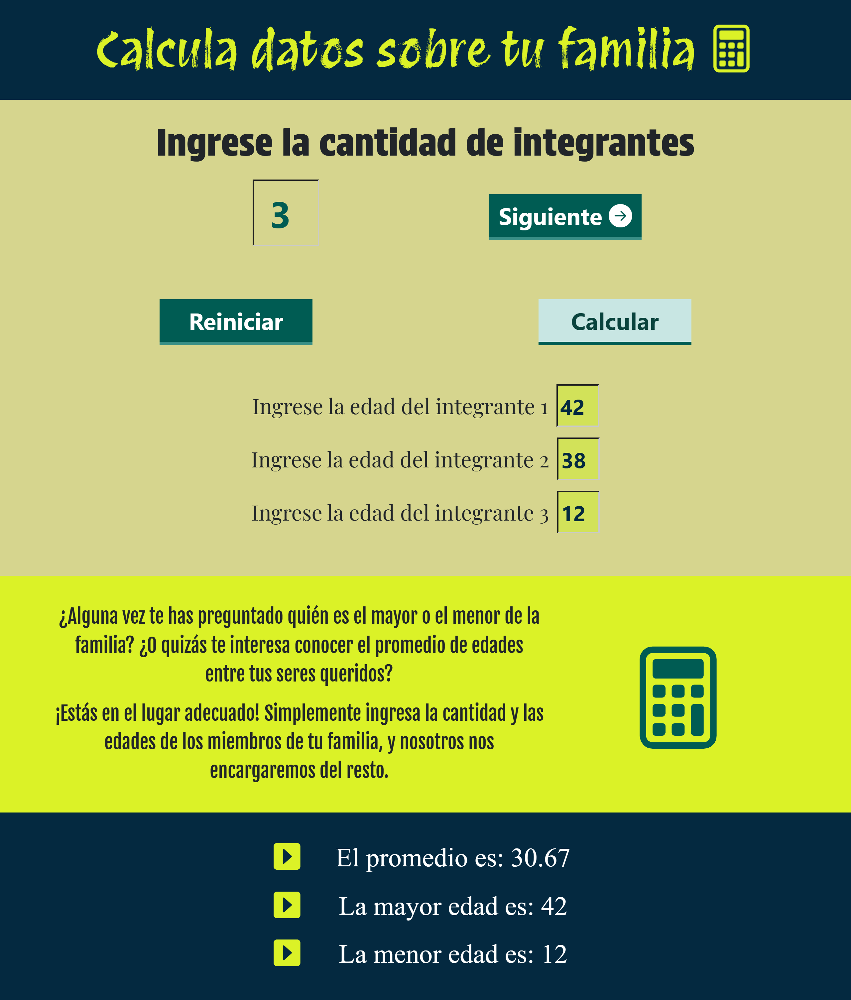

# Calculadora de edades familiares

Aplicación web estática para calcular la **mayor**, la **menor** y el **promedio** de las edades de una familia. Se ingresa la cantidad de integrantes, se completan las edades y la aplicación muestra los resultados al instante.

## Demo

**https://tejedasebastian.github.io/BUTTON-EDAD/**



## Características

- Cantidad de integrantes configurable entre 1 y 50.
- Campos de edad generados dinámicamente, con su etiqueta asociada.
- Validación de cantidad y edades vacías, no numéricas, cero o negativas.
- Promedio con dos decimales, mayor edad y menor edad.
- Mensajes de error visibles y accesibles (`role="alert"`).
- Resultados anunciados a lectores de pantalla (`aria-live="polite"`).
- Botón **Reiniciar** que limpia el formulario, elimina los campos y oculta los resultados.
- Diseño responsive sin desplazamiento horizontal en 390 px y 320 px.
- Un único `h1`, HTML en español (`lang="es"`) y labels correctamente asociados.

## Stack

| Capa | Tecnología |
| --- | --- |
| Estructura | HTML5 semántico |
| Estilos | CSS3 propio + Bootstrap 5.3 por CDN |
| Iconografía | Bootstrap Icons por CDN |
| Tipografías | Google Fonts (Protest Revolution, Protest Strike, Playfair Display, Fjalla One) |
| Lógica | JavaScript vanilla (sin frameworks) |
| Tests E2E | Playwright + Chromium |
| CI | GitHub Actions |
| Deploy | GitHub Pages desde la rama `gh-pages` |

## Estructura del proyecto

```text
.
├── .github/
│   └── workflows/
│       └── e2e.yml              # CI: instala dependencias y ejecuta Playwright
├── docs/
│   └── captura.png              # Captura usada en este README
├── tests/
│   └── e2e/
│       └── button-edad.spec.js  # Escenarios E2E
├── calculos-mio.js              # Funciones de cálculo (mayor, menor, promedio)
├── tarea-clase-6.js             # Validaciones, creación de campos y UI
├── icono1.png                   # Favicon
├── index.html
├── main.css
├── package.json
├── playwright.config.js
├── LICENSE
└── README.md
```

## Cómo correr el proyecto

Requisitos: **Node.js 20 o superior** y npm.

```bash
npm install
npm start
```

Abrí **http://localhost:4181**.

El script `empezar` también inicia el mismo servidor en el puerto 4181:

```bash
npm run empezar
```

## Tests

Los tests son **end-to-end** y usan Playwright como único mecanismo de prueba. No hay tests unitarios.

```bash
npm test
```

Playwright levanta automáticamente `http-server` en el puerto **4181**, ejecuta los escenarios en Chromium y genera:

- `playwright-report/`: reporte HTML.
- `artifacts/results.json`: resultados en formato JSON.
- `test-results/`: capturas, videos y traces de los tests fallidos.

Para ver el reporte HTML:

```bash
npx playwright show-report
```

### Escenarios cubiertos

- Dos integrantes con edades 20 y 10: promedio `15.00`, mayor `20`, menor `10`.
- Edad vacía: error visible, resultados ocultos y ausencia de `NaN`.
- Cantidad vacía, `0`, negativa o mayor que 50: error visible y sin campos de edad.
- Reiniciar: limpia la cantidad, elimina los campos y oculta los resultados.
- Móvil en 390 px y 320 px: sin overflow horizontal y sin errores de consola.
- Accesibilidad básica: un solo `h1`, labels asociados y región de resultados con `aria-live`.

### Tests contra el sitio publicado

La URL base se toma de la variable de entorno `BASE_URL`. Los tests navegan con `./`, de modo que respetan el subpath de GitHub Pages.

PowerShell:

```powershell
$env:BASE_URL="https://tejedasebastian.github.io/BUTTON-EDAD/"
npm test
```

Bash:

```bash
BASE_URL=https://tejedasebastian.github.io/BUTTON-EDAD/ npm test
```

Cuando `BASE_URL` está definida, Playwright no inicia el servidor local.

### Integración continua

El workflow [`.github/workflows/e2e.yml`](.github/workflows/e2e.yml) se ejecuta en cada push a `main`, en pull requests y de forma manual. Instala Chromium, corre la suite y sube como artefactos `playwright-report/` y `artifacts/`.

## Limitaciones

- Es una aplicación 100 % del lado del cliente: no guarda datos ni historial.
- Bootstrap, Bootstrap Icons y Google Fonts se cargan por CDN; sin conexión a internet se pierden estilos e iconos, aunque la lógica sigue disponible.
- La cantidad de integrantes está limitada a 50 para evitar formularios desproporcionados.
- El promedio se redondea a dos decimales.
- La suite E2E está configurada solo para Chromium.

## Licencia

Distribuido bajo la licencia [MIT](LICENSE).
